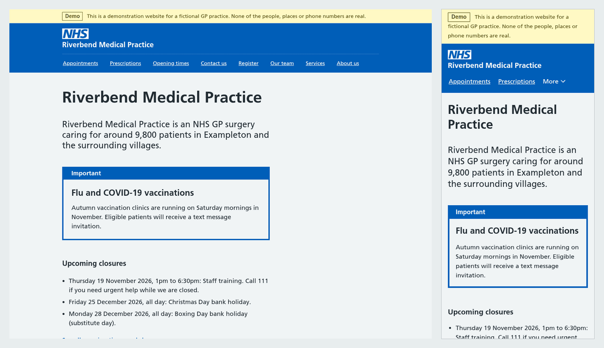

# Open GP Practice Website

A free, open source website template that lets a GP practice put a safe, NHS-style website online in an afternoon, with an AI assistant doing the technical work.

[](https://github.com/pacharanero/open-gp-practice-website/actions/workflows/ci.yml)
[](LICENSE)
[](LICENSES/CC-BY-SA-4.0.txt)



**[See the demo site](https://pacharanero.github.io/open-gp-practice-website/)** for Riverbend Medical Practice, which is entirely fictional.

**Status: early release, October 2026.** The template works and is tested, but it has not yet been reviewed by a Clinical Safety Officer or tried end to end by a practice. See [SAFETY.md](SAFETY.md) and the [roadmap](ROADMAP.md).

- [Why this exists](#why-this-exists)
- [What it is, and what it is not](#what-it-is-and-what-it-is-not)
- [Set up your practice's website](#set-up-your-practices-website)
- [Making changes later](#making-changes-later)
- [For ICBs, PCNs and digital teams](#for-icbs-pcns-and-digital-teams)
- [For developers](#for-developers)
- [Licence](#licence)

## Why this exists

In October 2026, GP practices in England and Wales began losing their websites after Silicon Practice, a supplier of practice websites, went into administration. Practices told [Pulse](https://www.pulsetoday.co.uk/news/breaking-news/gp-practices-websites-taken-down-after-company-enters-administration/) that "hundreds of GP practices nationwide" were affected, and one surgery said its website was deleted shortly before it received notification. Patients were left without an easy way to find phone numbers, opening times or how to ask for an appointment, and GPs told Pulse they were worried about the extra workload, because many patient contacts now come in through practice websites.

A GP practice website is mostly simple information that changes a few times a year: how to contact the practice, when it is open, how to request an appointment or a prescription, and the policies practices are expected to publish. That should not depend on a single company staying in business.

Open GP Practice Website is a rescue package and a long-term alternative:

- **Free.** The template is free, and the website is hosted for free on GitHub Pages.
- **Owned by the practice.** Each practice has its own copy, in its own account. If this project stopped tomorrow, every practice's website would keep working.
- **No technical skills needed.** A practice manager or admin team member answers questions in plain English. An AI assistant fills in the details, checks them and prepares the site. Nobody installs any software.
- **Safe by design.** Every page tells patients to call 999 in an emergency and 111 when the practice is closed, and that cannot be switched off. The site will not publish if key information such as the phone number or opening hours is missing. It has no forms, cookies or tracking, and never collects patient information. Health information links to nhs.uk rather than being written by the practice or the AI.
- **Familiar and accessible.** It is built on [NHS.UK frontend](https://github.com/nhsuk/nhsuk-frontend), the open source design used by the NHS website, which patients already recognise and which is built to meet accessibility standards.

## What it is, and what it is not

It **is** a website template with all the pages a GP practice needs, plus a set of instructions (a "skill") that teaches an AI assistant how to help practice staff fill it in safely. The assistant must never invent phone numbers or opening times, never write medical advice, and must get the practice to approve everything before it goes live.

It **is not**:

- an NHS England product, or endorsed by NHS England or any ICB
- an online consultation, booking or messaging system: it links to the one the practice already uses (Accurx, Klinik, PATCHS, eConsult and others)
- a replacement for the practice checking its own content: the practice is responsible for what its website says

What you get:

- pages for appointments and online consultation, prescriptions, test results, opening times, contact and directions, registration, the team, services, news, about the practice, and urgent help
- the information practices are expected to publish: privacy notice, complaints, accessibility statement, cookies, and in England the CQC rating and GP earnings declaration
- support for practices in England and Wales, including the right 111 service, complaints route and regulator for each

## Set up your practice's website

These steps are written for practice staff. You do not need any technical knowledge, and you will not need to install anything. Allow about an hour, most of it spent gathering your practice's details.

### What you need before you start

- **A shared practice email address**, such as a generic nhs.net mailbox that more than one person can access. Do not use a personal email address: the practice must keep access if staff leave.
- **A paid Claude plan** (Pro or above) for the AI assistant, [Claude Code on the web](https://claude.ai/code). Other AI assistants may work, but these steps have only been written for Claude.
- **Your practice's details**, or a colleague who knows them: your ODS code (practice code), main phone number and phone line hours, opening times for each site, the link to your online consultation form, and your privacy notice. In England, also your CQC location ID and GP earnings figures. The assistant will help you find the rest.

**Never share patient information with the AI assistant.** It does not need any.

### Step 1: Create a GitHub account

GitHub is a free service where your website's files will be kept and published.

1. Go to <https://github.com/signup>.
2. Sign up with your **shared practice email address**. Choose a username that identifies the practice, for example `riverbend-surgery`. This will appear in your free web address.
3. Confirm your email address when GitHub sends you a code.
4. GitHub will ask you to turn on two-factor authentication (a second check when you sign in). Do this using an authenticator app, and keep the recovery codes with the practice's other important passwords.

### Step 2: Make your own copy of this template

1. While signed in, go to <https://github.com/pacharanero/open-gp-practice-website>.
2. Click the **Fork** button near the top right. (A "fork" is GitHub's word for your own copy.)
3. Under **Repository name**, type a name for your website, for example `riverbend-surgery-website`.
4. Click **Create fork**. After a few seconds you will see your own copy, with your username at the top left.

### Step 3: Switch on publishing

1. In your copy, click the **Actions** tab.
2. You will see a message that workflows are not being run on this forked repository. Click **I understand my workflows, go ahead and enable them**.
3. Click the **Settings** tab, then **Pages** in the menu on the left.
4. Under **Build and deployment**, change **Source** to **GitHub Actions**.

Optional check: in the **Actions** tab, click **Publish to GitHub Pages** on the left, then **Run workflow**, then the green **Run workflow** button. After two or three minutes, the demo practice will appear at `https://<your username>.github.io/<your copy's name>/`, with a yellow "Demo" banner. This proves publishing works. Nobody else will be looking at it.

### Step 4: Connect the AI assistant

1. Go to <https://claude.ai/code> and sign in with your Claude account.
2. When asked, connect your GitHub account and approve the request.
3. If asked to install the Claude GitHub App, choose **Only select repositories** and pick your website copy. This lets the assistant suggest changes to your website and nothing else.

### Step 5: Ask the assistant to build your site

1. Open [this link to start a session with the request already written](https://claude.ai/code?prompt=I%20work%20at%20a%20GP%20practice%20and%20want%20to%20set%20up%20%28or%20update%29%20our%20practice%20website%20from%20this%20template.%20Please%20follow%20skill/gp-practice-website/SKILL.md%20and%20guide%20me%20step%20by%20step%20in%20plain%20English.), or go to <https://claude.ai/code> and type: _I work at a GP practice and want to set up our practice website from this template. Please follow skill/gp-practice-website/SKILL.md and guide me step by step in plain English._
2. Below the message box, click the repository selector and choose **your copy** (with your username), not `pacharanero/open-gp-practice-website`.
3. Press Enter. The assistant will ask you questions, a few at a time. Answer them, and correct anything it gets wrong.

### Step 6: Check and approve your site

1. The assistant will show you what patients will see and go through a sign-off checklist with you: phone numbers, opening times, addresses, the online form link and more. Check each one carefully. Wrong information on a GP website can delay care.
2. When everything is right, the assistant will prepare the change for you to approve. Click **Create PR** (a "pull request" is a proposed change).
3. Open the pull request on GitHub. **Check that it shows your username on both sides**, not `pacharanero`. If it shows `pacharanero`, stop and tell the assistant: your practice details must go to your own copy only.
4. Click **Merge pull request**, then **Confirm merge**. This publishes your website.

### Step 7: See your website live

1. In your copy, click the **Actions** tab. Wait for **Publish to GitHub Pages** to show a green tick, usually two or three minutes.
2. Your website is now at `https://<your username>.github.io/<your copy's name>/`. Open it on your phone and check the phone number and online form link work.

If you see a red cross instead, click it, copy the error text, and paste it to the assistant.

### Step 8: Point your web address at it and tell people

- **Your own web address**, such as `www.yoursurgery.nhs.uk`: ask the assistant to help. For addresses ending in nhs.uk, your ICB's IT team usually needs to make a change, and the assistant will write the email for you.
- **Update your NHS.UK profile** with the new web address, along with your Google Business Profile, social media and phone message.
- **Tell your ICB and Primary Care Network** that your website is back.

### Not using GitHub?

There is a second route: the [practice skill](skill/gp-practice-website/SKILL.md) can be added to Claude at claude.ai, and the assistant gives you a folder to drag and drop onto a free host such as Netlify (see [the publishing guide](skill/gp-practice-website/references/publishing.md)). Updates are more work this way, because you upload a new folder every time, and the skill is not yet packaged for easy download (roadmap R15). We recommend the GitHub route above.

## Making changes later

Start a new session at <https://claude.ai/code> on your copy, and say what you want in plain English, for example _"Change our Christmas opening hours"_ or _"Dr Patel has left and Dr Okafor has joined"_. The assistant will make the change, show you, and prepare it for you to approve and merge as in step 6.

When this template is improved, your copy will say it is behind `pacharanero/open-gp-practice-website`. Click **Sync fork**, then **Update branch**, and your site will republish with the improvements.

## For ICBs, PCNs and digital teams

- **Clinical safety**: [SAFETY.md](SAFETY.md) and the starter [hazard log](docs/clinical-safety/hazard-log.md) set out the hazards the template controls and how each control is tested. Each practice remains responsible for its own content and any local DCB0160 assessment.
- **Information governance**: the site collects no patient data and sets no cookies. Patient contact goes through the practice's existing online consultation supplier, the NHS App or the phone. Embedded code is only accepted from known suppliers.
- **Resilience**: each practice owns its copy and its hosting account. There is no shared server, database or company that can fail all practices at once.
- **Accessibility**: built on NHS.UK frontend, with HTML validation in every build and a generated accessibility statement for each practice.
- **NHS identity**: the code is open source, but the NHS logo, the NHS identity and the Frutiger font are not covered by this licence. GP practices may use the NHS logo under the NHS identity guidelines. Practices not entitled to it can use their own logo (`site.logo`).

## For developers

You need Node.js 24 (see `.nvmrc`).

```sh
npm ci
s/check      # check the practice details in practice/
s/preview    # preview at http://localhost:8080
s/test       # unit tests and full build tests
s/lint       # ESLint and Prettier
s/build      # build to _site/
```

See [s/README.md](s/README.md) for options.

```text
practice/
  practice.yaml       All the practice's details. This is the file practices edit.
  pages/*.md          The privacy notice, plus any extra pages, in Markdown.
  images/             Optional logo and images.
src/                  Page templates and layouts. Practices should not need to edit these.
lib/practice.js       Loads and checks the practice details.
skill/                The AI assistant skill and its reference guides.
tests/                Unit and build tests, with demo and Wales practice fixtures.
docs/                 Clinical safety documentation and images.
```

The site is built with [Eleventy](https://www.11ty.dev/) and uses the NHS.UK frontend Nunjucks macros directly. When the site builds, `lib/practice.js` checks the practice details, and the build stops with plain-English explanations if anything patients rely on is missing or wrong: the phone number, opening hours for every day, the online consultation link, required published information, or leftover placeholder text such as TODO. Embedded code is only allowed from known suppliers unless the practice adds a domain explicitly.

The `Publish to GitHub Pages` workflow builds and publishes on every push to `main`, both here (the demo) and in each practice's copy.

AI coding agents should start at [agent-instructions.md](agent-instructions.md). To contribute, see [CONTRIBUTING.md](CONTRIBUTING.md). Report security issues privately as described in [SECURITY.md](SECURITY.md).

## Licence

Code is released under the [MIT Licence](LICENSE). Documentation, safety documents and the practice skill are released under [CC BY-SA 4.0](LICENSES/CC-BY-SA-4.0.txt). Copyright 2026 Marcus Baw. Each practice's own content in its copy of `practice/` belongs to that practice.

NHS.UK frontend is © NHS England and released under the MIT Licence.
